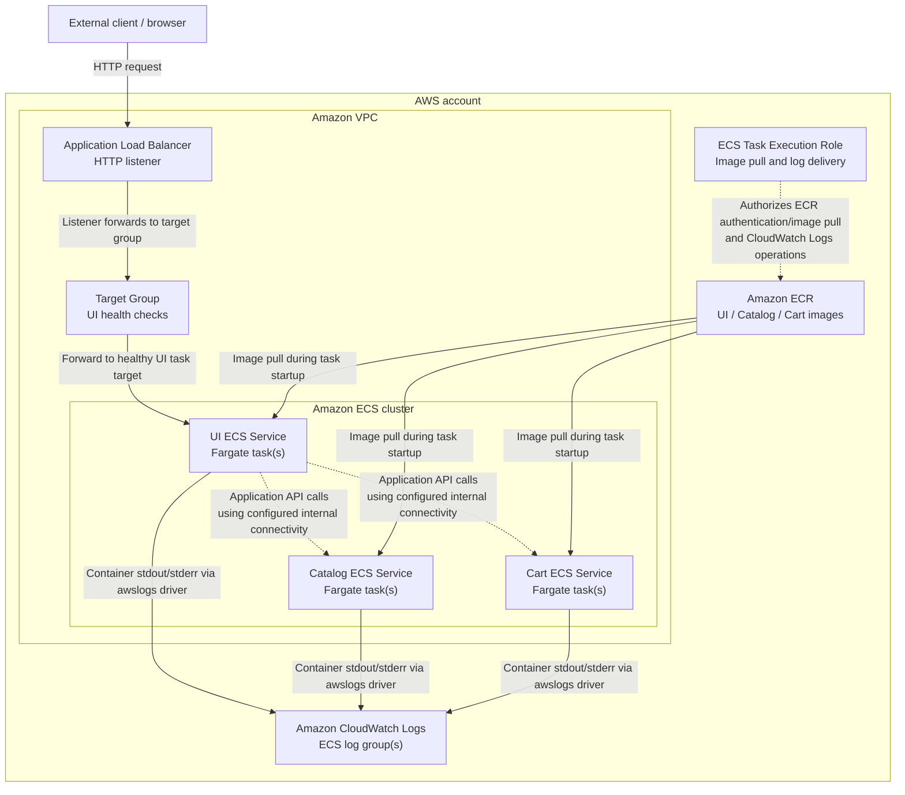

# AWS Container Platform Architecture

## 1. Purpose

This document describes the container platform implemented for Milestone 3 of the `retail-store-sample-app` DevOps project. It explains how the application is exposed, how ECS runs the container workloads, how images are retrieved from Amazon ECR, how network access is restricted, and how application logs are delivered to Amazon CloudWatch Logs.

The document focuses on architecture and operational flow. Detailed resource configuration remains defined in Terraform and the application repository.

> **Implementation accuracy:** This document describes the intended Milestone 3 architecture based on the project scope. Before merging, verify resource names, ports, subnet placement, IAM permissions, logging configuration, and service-to-service discovery against the final Terraform configuration and deployed AWS resources. Update any statement that differs from the implementation.

## 2. Scope

This milestone covers the following application services:

- **UI** — the user-facing application entry point.
- **Catalog** — the product catalog service.
- **Cart** — the shopping cart service.

Checkout, Orders, and other out-of-scope application services are not part of this milestone.

The platform components covered here are:

- Amazon VPC networking and subnets
- Application Load Balancer (ALB), listener, and target group
- Amazon ECS cluster, task definitions, services, and Fargate tasks
- Amazon ECR repositories and container images
- IAM task execution role
- Security Groups
- Amazon CloudWatch Logs
- Terraform-managed infrastructure and the manual deployment workflow

## 3. Architecture Overview

The platform uses Amazon ECS with AWS Fargate to run the selected application containers without requiring management of EC2 worker instances. Container images are stored in Amazon ECR. The ALB provides the external HTTP entry point and forwards requests to the UI service. The Catalog and Cart services support application functionality and should receive only the traffic required by the implemented application flow.

The application and infrastructure are managed separately: application images are built and published to ECR, while Terraform defines the AWS infrastructure.

### 3.1 Architecture diagram

The following diagram represents the logical platform. Confirm the subnet placement, service discovery mechanism, data-store connections, and exact listener/target-group associations against the deployed environment before treating the diagram as final.



**Diagram notes**

- The ALB is the public entry point only if its scheme and subnet placement are configured as internet-facing.
- The diagram shows the ALB forwarding to the UI target group. Confirm that the deployed listener and target group are associated this way.
- Dashed application links represent logical service calls, not a claim that a particular service-discovery mechanism has been configured. Document the actual DNS names, Cloud Map/ECS Service Connect setup, or other connectivity mechanism used by the deployment.
- Image-pull and logging permissions are normally granted through the ECS task execution role. Application code that calls AWS APIs may require a separate task role; do not treat the execution role as the application's general-purpose AWS identity.
- Add the actual subnet and data-store components if they are in the deployed Milestone 3 architecture.

## 4. Request and Network Traffic Flow

### 4.1 External request to the UI

1. A client sends an HTTP request to the ALB DNS name.
2. The ALB listener receives the request on its configured listener port.
3. The listener forwards matching requests to the configured target group.
4. The target group routes traffic to a healthy UI task target on the configured container port.
5. The UI processes the request and, when required, calls Catalog or Cart through the application's configured internal connectivity.

The ALB does not automatically make Catalog and Cart private. Their reachability depends on subnet routing, public IP assignment, Security Group rules, and any service-discovery or routing configuration. Verify those controls in the deployed environment.

### 4.2 Security Group boundaries

Security Groups are stateful virtual firewalls attached to the ALB network interfaces and ECS task network interfaces. The intended least-privilege relationship is:

| Component | Intended inbound access | Purpose |
|---|---|---|
| ALB Security Group | HTTP from the intended client range; use HTTPS instead if TLS is implemented | Accept client requests |
| UI task Security Group | Application traffic from the ALB Security Group on the UI container port | Prevent direct application access that bypasses the ALB |
| Catalog task Security Group | Only the required application traffic from the UI or other explicitly authorized callers | Keep the service restricted to its callers |
| Cart task Security Group | Only the required application traffic from the UI or other explicitly authorized callers | Keep the service restricted to its callers |

The table describes the security intent, not a substitute for the actual rules. Replace the generic port descriptions with the exact ports and sources from the deployed Security Group rules.

Important checks:

- The ALB Security Group must allow inbound traffic on the listener port.
- The ALB Security Group must allow outbound traffic to the UI target port.
- The UI task Security Group must allow inbound traffic from the ALB Security Group on the UI port.
- Catalog and Cart task Security Groups should allow only the required caller Security Groups and service ports.
- ECS tasks may need outbound connectivity to retrieve images, send logs, and reach application dependencies. The actual egress path depends on subnet routes, public IP assignment, NAT, and/or VPC endpoints.
- Do not describe a task as private solely because it has a restrictive Security Group. Network placement and routing must also be checked.

### 4.3 Subnets and routing

Document the actual subnet model used by the deployed Terraform configuration:

- **ALB subnet placement:** `[Confirm public subnets and ALB scheme]`
- **ECS task subnet placement:** `[Confirm public or private subnets]`
- **Outbound connectivity:** `[Confirm Internet Gateway route, public IP assignment, NAT, and/or VPC endpoints]`

If ECS tasks run in public subnets without a NAT Gateway, confirm whether tasks receive public IP addresses and whether the route table has a route to an Internet Gateway. If tasks run in private subnets, document the NAT or VPC endpoint path required for ECR image pulls and CloudWatch Logs delivery.

## 5. Amazon ECR and Container Image Lifecycle

Amazon Elastic Container Registry (ECR) stores the application container images that ECS uses to start tasks. Each selected service should reference the repository and image tag configured for its task definition.

The high-level image lifecycle is:

1. Build the service's container image from the application source and Dockerfile.
2. Tag the image with the intended ECR repository and a traceable version, preferably an immutable identifier such as a Git commit SHA.
3. Authenticate the Docker client to the appropriate ECR registry.
4. Push the image to the service's ECR repository.
5. Configure the ECS task definition with the repository URI and image tag.
6. When ECS starts a task, the ECS/Fargate platform retrieves the image from ECR.
7. ECS starts the container using the task definition's container configuration.

Use the exact repository names, AWS Region, and tagging convention from the implementation. Do not include AWS account IDs, credentials, or other sensitive values in documentation screenshots or examples.

### Why ECR is used

- Provides a managed private registry for container images.
- Integrates with IAM for registry authentication and access control.
- Allows ECS task definitions to reference versioned application images.
- Separates image build/publish activities from runtime orchestration.

### Image-pull permissions

The **ECS task execution role** is used by the ECS/Fargate agent for operations such as authenticating to ECR, pulling private images, and sending container logs to CloudWatch Logs when the task definition uses the `awslogs` log driver.

This role is distinct from the **task role**, which provides AWS permissions to application code running inside a container. If the application itself calls AWS APIs, document the task role and its permissions separately.

An image pull can fail even when IAM permissions are correct if the task cannot reach the required AWS endpoints. Troubleshooting should therefore check both IAM authorization and network connectivity.

## 6. ECS Runtime Components

Amazon ECS manages the lifecycle of the selected container workloads. AWS Fargate supplies the compute capacity for tasks, so this design does not require the project to manage an ECS cluster of EC2 instances.

| ECS component | Responsibility |
|---|---|
| ECS cluster | Logical grouping for ECS services and tasks |
| Task definition | Versioned blueprint describing container image, ports, CPU/memory, environment configuration, logging, and IAM roles |
| ECS service | Maintains the configured desired task count and manages task replacement/deployment |
| Fargate task | Running instance of a task definition |
| Container | The application process running inside the task |

### Task startup at a high level

1. The ECS service requests a task according to its desired count and deployment configuration.
2. Fargate provisions the task's runtime environment and network interface.
3. The ECS/Fargate agent uses the task execution role for required startup operations.
4. The image is retrieved from ECR.
5. The container is started with the task definition configuration.
6. The configured log driver sends container logs to CloudWatch Logs.
7. If the service is associated with an ALB target group, the target is registered and health checks determine whether it can receive traffic.

The actual CPU, memory, desired count, container ports, health checks, and deployment settings are defined in Terraform/task definitions. Refer to those resources rather than duplicating all configuration values here.

## 7. ALB, Listener, and Target Group

The Application Load Balancer provides the HTTP entry point for the application and distributes requests to registered targets.

- **ALB:** Provides the load-balancing endpoint and attaches to the configured subnets and Security Group.
- **Listener:** Listens on a configured protocol and port and evaluates listener rules.
- **Target group:** Defines the targets, target port/protocol, and health-check settings.
- **ECS service integration:** Registers or deregisters task targets as tasks are launched, replaced, or stopped, when the service is configured with the target group.

For the current project, document the actual mapping:

| Setting | Deployed value |
|---|---|
| ALB scheme | `[Verify: internet-facing or internal]` |
| Listener | `[Verify: protocol and port]` |
| Listener action | `[Verify: forward action and target group]` |
| Target type | `[Verify: typically IP for Fargate awsvpc tasks]` |
| Target container/port | `[Verify from ECS task definition and target group]` |
| Health-check path and port | `[Verify from target group configuration]` |

A running ECS task is not necessarily a healthy ALB target. If the target is unhealthy, verify the application is listening on the configured port, the health-check path returns a successful response, and the Security Groups allow ALB-to-task traffic.

## 8. Centralized Logging with CloudWatch Logs

The ECS task definition can configure the `awslogs` log driver to send container standard output and standard error to Amazon CloudWatch Logs.

The flow is:

1. The application writes logs to stdout/stderr.
2. The container's configured log driver forwards log events to CloudWatch Logs.
3. Events are stored in the configured log group and log stream.
4. Contributors use the CloudWatch Logs console or CLI to inspect application output and investigate failures.

Verify and document these values from the deployed task definitions:

- Log driver: `[Verify: awslogs or other driver]`
- Log group per service: `[Insert exact log group name(s)]`
- Region: `[Insert deployed Region]`
- Stream prefix: `[Verify configured stream prefix]`
- Retention policy: `[Verify configured retention; do not assume a default]`

The task execution role needs the required CloudWatch Logs permissions when the `awslogs` driver is used. If a task fails before its container starts, application logs may not exist; check ECS service events and the stopped-task reason as well.

## 9. Manual Deployment Workflow

Milestone 3 uses a manual deployment workflow. Replace the generic steps below with the exact commands and order used in the repository before marking this section verified.

1. **Build** the container image for the service being changed.
2. **Tag** the image with the target ECR repository and a traceable version.
3. **Authenticate** to ECR using the approved AWS identity.
4. **Push** the image to ECR.
5. **Update** the relevant ECS task definition to reference the intended image tag, if the current workflow requires a task-definition change.
6. **Register/update** the task definition and update the ECS service using the documented deployment procedure.
7. **Verify** the ECS service reaches the intended desired/running task count.
8. **Verify** the ALB target is healthy and the application endpoint responds as expected.
9. **Inspect logs** in CloudWatch Logs if the task fails to start or the application returns an error.

Do not use `latest` as the only release identifier when a deterministic rollback is required. Record the image tag and task-definition revision used for each deployment.

### Post-deployment verification checklist

- [ ] The intended image tag exists in the correct ECR repository.
- [ ] The ECS service references the expected task-definition revision.
- [ ] The ECS service has the expected running task count.
- [ ] The target group reports the UI target as healthy.
- [ ] The application endpoint responds successfully.
- [ ] Container logs are visible in the expected CloudWatch log group.
- [ ] No credentials, account-sensitive details, or secret values are present in screenshots or logs shared in the repository.

## 10. Operational Troubleshooting Guide

| Symptom | First checks |
|---|---|
| ECS task cannot pull an image | Confirm image URI/tag, execution-role permissions, Region/account, task subnet routes, public IP/NAT/VPC endpoint connectivity, and outbound HTTPS access |
| ECS task stops during startup | Inspect ECS service events and the task's stopped reason; check image pull, container command, environment configuration, and resource settings |
| ALB target is unhealthy | Check target-group health-check path/port, application bind address, container port mapping, and ALB-to-task Security Group rules |
| UI cannot reach Catalog or Cart | Confirm application endpoint configuration, service discovery/DNS, destination port, task Security Group ingress, and network routing |
| No container logs appear | Check the task definition's log configuration, log group/Region, execution-role permissions, and whether the container started |
| Application returns HTTP 5xx | Correlate ALB target health, ECS task events, application logs, and downstream service connectivity |

## 11. Verification Evidence

Add real screenshots from the final Milestone 3 deployment. Store them in a repository directory such as `docs/aws/images/` and use relative links so they render in GitHub.

Recommended evidence:

1. **ALB listener and target group** — show the listener forwarding action and target-group association.
2. **Healthy target** — show the UI target's health status and target port.
3. **ECS service and running task** — show the service name, desired/running count, and task status.
4. **Task definition image and logging configuration** — show the ECR image URI/tag and `awslogs` settings. Mask account-specific identifiers if required by the project's sharing policy.
5. **ECR repository image** — show the repository and pushed image tag.
6. **CloudWatch Logs** — show the relevant log group and a sample application log event.
7. **Security Group rules** — show the ALB ingress rule and ALB-to-UI task traffic rule. Include Catalog/Cart rules if they are part of the deployed platform.

Insert screenshots using relative paths, for example:

```markdown
### ALB listener and target group


### ECS service and running task


### ECR image


### CloudWatch Logs


### Security Group traffic rules


```

The example image paths are placeholders. Replace them with actual screenshots committed to the repository. Never create fabricated evidence or commit screenshots containing access keys, passwords, secret values, session tokens, or other sensitive information.

## 12. Security and Documentation Notes

- Do not commit AWS access keys, secret keys, passwords, session tokens, or application secrets.
- Mask account IDs, internal identifiers, and other details if required by the repository's sharing policy.
- Avoid copying complete Terraform resource blocks into this document. Link to the relevant Terraform files/modules instead.
- Keep the diagram aligned with the deployed configuration. Update it whenever subnet placement, listener rules, ports, service connectivity, IAM roles, or logging configuration changes.
- Treat production-readiness improvements as future work unless they have actually been implemented.

## 13. Related Implementation References

Add repository-relative links to the actual files before merging:

- Terraform environment/configuration: `[link to the relevant Terraform directory]`
- ECS task definitions and services: `[link to the relevant Terraform module/resource files]`
- ALB and Security Groups: `[link to the relevant Terraform files]`
- ECR repositories: `[link to the relevant Terraform files]`
- CloudWatch log configuration: `[link to the relevant Terraform files]`
- Manual deployment instructions: `[link to the relevant README or runbook]`

## 14. External References

- [Amazon ECS documentation](https://docs.aws.amazon.com/AmazonECS/latest/developerguide/Welcome.html)
- [Amazon ECR documentation](https://docs.aws.amazon.com/AmazonECR/latest/userguide/what-is-ecr.html)
- [AWS Fargate documentation](https://docs.aws.amazon.com/AmazonECS/latest/developerguide/AWS_Fargate.html)
- [Elastic Load Balancing documentation](https://docs.aws.amazon.com/elasticloadbalancing/latest/application/introduction.html)
- [Amazon CloudWatch Logs documentation](https://docs.aws.amazon.com/AmazonCloudWatch/latest/logs/WhatIsCloudWatchLogs.html)
